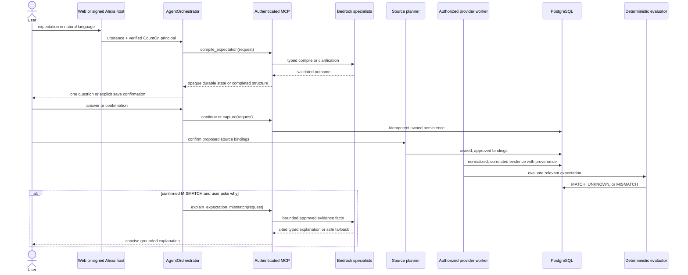

# CountOn specialist orchestration

## Decision

**Decision A: preserve the existing orchestration.** CountOn already has a bounded
coordinator, typed specialist contracts, durable production conversation state,
authenticated MCP capabilities, source authorization, deterministic monitoring,
and safe model fallbacks. A second agent framework would duplicate routing and
state, widen the authorization surface, and make the evaluator boundary harder to
audit. No Bedrock Agents, AgentCore, Strands, LangGraph, CrewAI, or new MCP tools
were added.

The word *specialist* below describes a focused responsibility. Only the compiler,
clarification interpreter, and mismatch investigator call a foundation model.
Source planning, provider extraction, routing, persistence, evaluation,
notifications, and audit are deterministic Python services.

## Current architecture

| Responsibility | Implementation and contract | Model use | Authority |
|---|---|---:|---|
| Coordinator | `backend/app/agent/orchestrator.py`; `AgentInput -> AgentPlan -> AgentResult -> TrustResponse` from `app/agent/models.py` | No | Routes through a closed capability registry, carries the verified principal, enforces confirmation and bounded execution |
| Expectation compiler | `app/ai/expectation_compiler.py`; `text + CompileContext -> CompileOutcome` | Bedrock Runtime | Proposes a grounded `CompiledExpectation`, clarification, or unsupported result; cannot save it |
| Clarification specialist | `app/ai/clarification.py`; `ClarificationState + answer + CompileContext -> ClarificationTurn` | Bedrock Runtime for typed field patches | Applies quoted, verified patches; deterministic code handles cancellation, correction policy, topic replacement, deadlines, expiry, and turn limits |
| Source planner | `app/services/source_planning_service.py`; owned expectation, query, usable connection grants -> `SourcePlan`, then confirmed plan -> bindings | No | Proposes only currently authorized records and requires `confirmed=true`; it cannot expand OAuth scopes |
| Evidence interpreter | `app/integrations/normalization.py`, `adapters.py`, `worker.py`, Ring/Bee adapters | No | Narrow provider-specific extraction and correlation; external text remains untrusted data and unrelated content is discarded |
| Mismatch investigator | `app/ai/mismatch_investigator.py` through `app/services/investigation_service.py`; owned expectation + latest MISMATCH evaluation + bounded evidence -> `MismatchExplanation` | Bedrock Runtime with deterministic fallback | May describe supplied facts and cite E1…E99; cannot create or change an evaluation |
| Evaluator | `app/evaluators/` and `app/services/evaluation_service.py` | No | Sole authority for `MATCH`, `UNKNOWN`, and `MISMATCH` |
| Monitoring and notifications | `app/monitoring/worker.py`, `app/notifications/worker.py` | No | Durable leasing, retries, idempotent evaluation/notification transitions, and dead-letter behavior |
| MCP boundary | `app/mcp/server.py`, `tools.py`, `intelligence.py` | Only through compiler/investigator services | Six bearer-authenticated tools, each accepting exactly `{ "request": ... }`; ownership is derived from the verified JWT |

The six stable MCP capabilities are `capture_expectation`, `get_expectation`,
`list_expectations`, `compile_expectation`,
`continue_expectation_compilation`, and `explain_expectation_mismatch`.
Streamable HTTP remains the transport.

## Coordinator sequence



## State, approval, and recovery

Production config uses `conversation_store_backend=postgres` and
`PostgresAgentSessionStore` / `PostgresAlexaConversationStore` in
`app/conversations/stores.py`. Handles are opaque, owner-bound, leased, rotated on
each turn, encrypted at rest by the conversation record layer, and expire within a
bounded TTL. The MCP compilation ledger in `app/mcp/compilation_lifecycle.py`
stores the canonical clarification state and atomically consumes a compiled state
with expectation creation. This prevents completed, cancelled, expired, or replayed
state from creating duplicate rows. The in-memory stores are local/test fallbacks,
not the production durability mode.

Capture requires an explicit confirmation in the web and Alexa orchestration
paths. Source activation separately requires a confirmed source plan. A compiled
expectation does not imply source access, and a connected provider does not imply
permission for every expectation.

Monitoring workers use PostgreSQL leases and idempotency keys. Model failures never
change evaluator results: compilation fails safely, clarification remains bounded,
and mismatch investigation returns a deterministic grounded fallback. Provider
authorization failures stop synchronization; retryable jobs use bounded backoff
and terminal failures are recorded for operations review.

## Amazon Bedrock Runtime

The backend uses the AWS SDK credential provider chain and `bedrock-runtime`
`Converse`; credentials are not application settings. The canonical sample is
`backend/bedrock.env.sample`:

```text
BEDROCK_ENABLED=false
AWS_REGION=us-east-2
BEDROCK_MODEL_ID=openai.gpt-oss-120b-1:0
BEDROCK_MAX_TOKENS=1000
BEDROCK_TEMPERATURE=0.1
BEDROCK_REQUEST_TIMEOUT_SECONDS=30
BEDROCK_MAX_RETRIES=2
```

`app/ai/bedrock_client.py` adds per-operation model overrides, a total operation
deadline, SDK connect/read timeouts, an application-owned retry policy with bounded
backoff, a concurrency gate, and a total token budget. It parses exactly one JSON
document, rejects duplicate keys and non-finite values, validates strict Pydantic
output, and permits one bounded repair attempt that does not echo the invalid model
response. Telemetry records safe operational labels, latency, token counts when
available, retries, and validation state. It never logs prompts, user text, model
responses, credentials, or Authorization headers.

### Live versus fixture validation

On 2026-10-13, the local SDK located the configured credential provider, but the
safe STS preflight failed with `LoginRefreshRequired`. Identity, region access,
model availability, IAM permission, and a real model response therefore remain
**not live verified**, and no paid Bedrock invocation was attempted. Refresh the
local AWS login, then run:

```bash
cd backend
AWS_EC2_METADATA_DISABLED=true .venv/bin/python db/scripts/aws_preflight.py --verify-identity
AWS_EC2_METADATA_DISABLED=true BEDROCK_ENABLED=true .venv/bin/python db/scripts/bedrock_smoke.py --live
```

The second command validates harmless JSON without printing raw output. A remote
identity PASS and smoke PASS are still required before claiming live Bedrock
acceptance. Offline tests use controlled Runtime fixtures; they verify request
shape, structured compilation, Pydantic rejection and repair, timeout/retry/token
budgets, grounded citations, and fallback behavior, but do not prove AWS access or
model quality.

## Deterministic boundary and grounding

- AI interprets language and proposes typed facts. It does not write provider
  grants, evidence, evaluations, or notifications.
- Source eligibility comes from owned connection grants, confirmed bindings, and
  deterministic correlation rules. The system never autonomously requests a wider
  OAuth scope or connects an account.
- Email, calendar, Ring, and Bee payloads are data. Provider normalizers select
  narrow fields and identifiers; prompt-like text cannot select tools or override
  evaluation.
- The investigator runs only after an owned latest evaluation says `MISMATCH`.
  Evidence is filtered by the expectation's source policy, normalized to bounded
  E-identifiers, and post-validated. Unknown or denied citations cause a safe
  deterministic fallback.
- Missing, stale, conflicting, or insufficient evidence remains `UNKNOWN` or yields
  a cautious explanation. Ring silence is not nondelivery, and a Bee promise is not
  proof that an event occurred.
- MCP tools have strict input/output models, a single `request` argument, bearer
  authentication, owner-scoped services, a request deadline, and no payload user ID.
  The coordinator has a fixed capability allowlist and no uncontrolled loop.

## Trace and audit design

Internal traces use request/run/evaluation/evidence IDs and safe operation labels.
The shared append-only audit contract records `EXPECTATION_CONFIRMED`,
`SOURCE_AUTHORIZED`, `EVIDENCE_INGESTED`, `EVALUATION_COMPLETED`,
`EXPLANATION_GENERATED`, `NOTIFICATION_CREATED`, and `NOTIFICATION_SENT` where the
corresponding action occurs. The explanation event links the expectation,
evaluation, accepted evidence IDs, source categories, grounding result, Bedrock
attempt/use flags, and fallback flag. It stores no speech, transcript, model prompt,
model response, evidence value, email body, Bee transcript, token, or credential.
Audit metadata is allowlisted, owner-scoped, and uses pseudonymous provider
references.

## Validation coverage

The local suites cover the requested workflow through these areas:

| Requirement | Primary coverage |
|---|---|
| Web/Alexa input, compilation, clarification, confirmation | `test_agent.py`, `test_agent_sessions.py`, `test_agent_api.py`, `test_alexa.py`, `test_expectation_compiler.py`, `test_clarification.py` |
| Source recommendation and confirmation | `test_source_planning.py`, `test_automatic_tracking.py`, `test_provider_sync.py` |
| Email and calendar interpretation | `test_provider_sync.py`, `test_microsoft_provider.py` |
| Ring and Bee simulator evidence | `test_simulator_authorization.py`, `test_simulator_ingestion.py`, `test_adapters_and_simulators.py` |
| Deterministic evaluation and notifications | `test_numeric_evaluator.py`, `test_other_evaluators.py`, `test_monitoring.py`, `test_automatic_tracking.py` |
| Grounded mismatch explanation | `test_mismatch_investigator.py`, `test_mcp_intelligence.py`, `test_trust.py` |
| Timeout, malformed output, retry and budgets | `test_bedrock.py`, `test_orchestration_budgets.py`, `test_production_security.py` |
| Prompt injection and data minimization | `test_expectation_compiler.py`, `test_clarification.py`, `test_provider_sync.py`, `test_trust.py` |
| Tenant isolation and tool authorization | `test_ownership.py`, `test_mcp_services.py`, `test_mcp_intelligence.py`, `test_agent_api.py` |
| Audit minimality | `test_audit_history.py`, `test_trust.py` |
| Restart recovery and idempotency | `test_production_conversations.py`, `test_compilation_lifecycle.py`, `test_monitoring.py`, `test_notifications.py` |

See the current command results in the task report. Fixture and mocked-provider
tests establish local behavior only; live Google/Microsoft/Bee/Alexa/AWS acceptance
remains separate.

### Validation record (2026-10-13)

| Command/category | Result |
|---|---|
| `python -m pytest -q --tb=short` with isolated loopback `counton_test` | PASS — 1,312 tests; 104 upstream ASK SDK deprecation warnings |
| Focused trust/audit regression | PASS — 20 tests |
| Ruff | PASS |
| Mypy application scope | PASS — 158 source files |
| Strict intelligence/orchestration Mypy scope | PASS — 37 source files |
| Production smoke | PASS — API startup, six MCP contracts, Streamable HTTP, signed Alexa path, durable conversations, monitoring, source planning, correlation, budgets, and recovery |
| Synthetic orchestration evaluation | PASS — 26/26; zero Bedrock calls; human review and live-provider categories remain blocked |
| Frontend lint / typecheck / tests / build | PASS / PASS / PASS (238, one skipped) / PASS |
| Bandit medium/high gate | PASS |
| `pip-audit` / `npm audit --audit-level=high` | PASS — no known vulnerabilities / zero vulnerabilities |
| Pinned Gitleaks history and source scan | PASS — zero findings |
| `git diff --check` | PASS |
| AWS credential and identity preflight | BLOCKED — local provider requires login refresh; identity values suppressed |
| Real Bedrock Runtime request | NOT RUN — prerequisite identity preflight did not pass |

The first full backend attempt lost its local PostgreSQL container partway through
and ended with connection-refused setup errors. After restarting and confirming the
repository's database service healthy, the clean full rerun produced the passing
result above. No application assertion failure from the interrupted run was treated
as a product defect.

## Remaining blockers

1. Refresh the configured AWS login, then verify STS, `us-east-2` model access,
   `bedrock:InvokeModel`, the harmless smoke request, a real structured compiler
   response, and a real grounded mismatch response with latency/cost observation.
2. Run live provider acceptance with separately authorized test accounts. Local
   provider tests use HTTP fixtures and simulators and do not prove provider grants.
3. Validate production uses the PostgreSQL conversation store, encryption key,
   migrations, and worker processes; local in-memory state is unsuitable for a
   multi-instance deployment.
4. Complete ASK console/Echo acceptance separately. Signed local ASK tests do not
   establish a live Alexa device integration.
